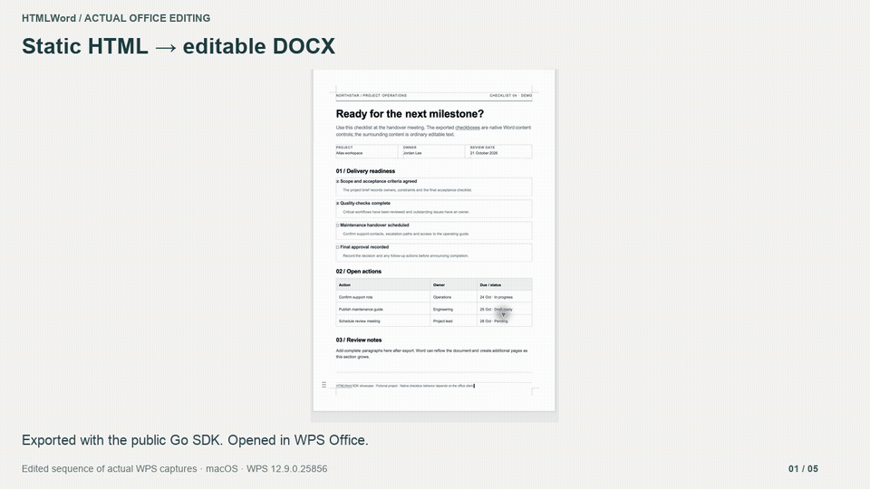
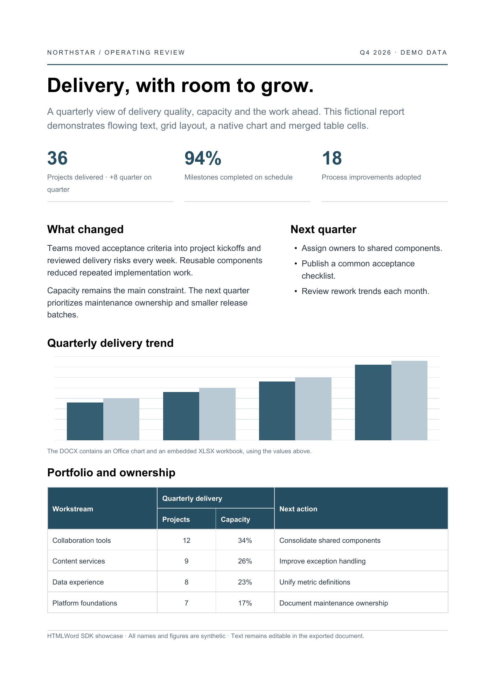
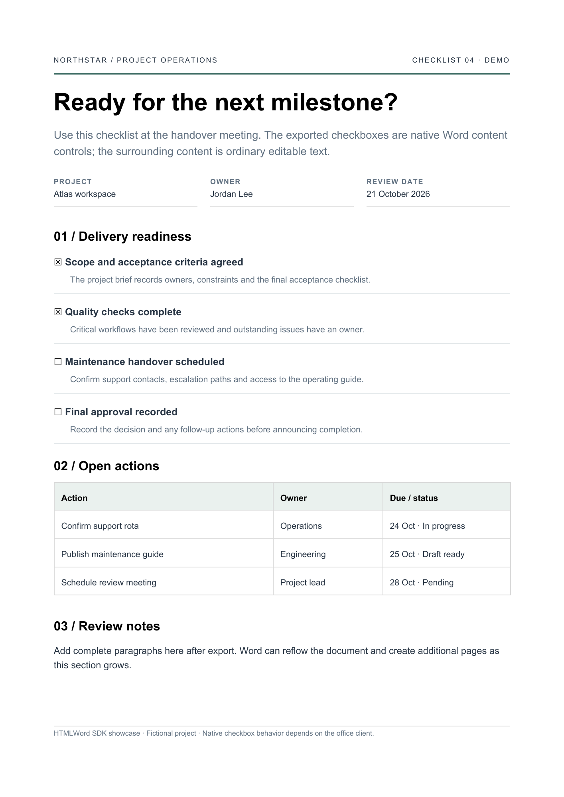

# HTMLWord — HTML to Word (DOCX) in Go

[English](README.md) · [简体中文](README.zh-CN.md)

[](https://github.com/xinhaolin/htmlToWord/actions/workflows/ci.yml) [](https://pkg.go.dev/github.com/xinhaolin/htmlToWord) [](https://github.com/xinhaolin/htmlToWord/releases)

将**静态 HTML 和 CSS 转成可编辑、能自然重排和跨页的 DOCX** 的 Go SDK。文字、列表和表格保留为原生文档内容；在办公软件中插入整段文字后，文档可以重新排版并增加页面。

HTMLWord 用 Chromium 测量浏览器布局，用 Go OOXML 写入器生成文档，**没有第三方 Go 模块依赖**。运行时需要单独安装 Chrome 或 Chromium；LibreOffice 和前端验证页面属于可选开发工具。

源码仓库：[xinhaolin/htmlToWord](https://github.com/xinhaolin/htmlToWord) · 许可证：[Apache-2.0](LICENSE)

## 快速安装

```sh
go get github.com/xinhaolin/htmlToWord@v0.1.0
```

[文档](https://xinhaolin.github.io/htmlToWord/zh/) · [完整 Go 示例](examples/basic/main.go) · [12 个复杂案例](https://xinhaolin.github.io/htmlToWord/examples/) · [版本与样例下载](https://github.com/xinhaolin/htmlToWord/releases/tag/v0.1.0)

Chrome/Chromium 是独立运行时依赖。支持 Go 1.23+、macOS 和 Linux。

## 看看导出之后

实际 WPS 编辑画面的剪辑演示：修改文字、复选框交互和自然跨页。素材来源与保存后检查见[演示记录](docs/assets/editing-demo.json)。

[](https://xinhaolin.github.io/htmlToWord/assets/editing-demo.mp4)

<details>
<summary>查看 DOCX 实际渲染截图</summary>

## 实际导出截图

以下图片来自公开 SDK 生成的 DOCX，再由 LibreOffice 实际渲染。它们不是浏览器截图，也不代表所有 Word/WPS 版本的显示效果完全一致。仓库中包含输入 HTML 和截图来源记录。



[HTML 源文件](testdata/html/sdk-report.html) · 原生 Office 图表及其内嵌 XLSX 数据，配合连续段落和合并单元格。



[HTML 源文件](testdata/html/sdk-form.html) · 四个原生复选框内容控件、可编辑表格及可继续增加段落的备注区域。静态截图不能证明点击行为，具体证据见[验证范围](docs/validation.md)。

</details>

## 运行要求和安装

- Go **1.23 或更高版本**。
- 单独安装 Chrome 或 Chromium，并为浏览器和目标办公软件配置所需字体。
- macOS 或 Linux。当前管道通信实现明确不支持 Windows。本地渲染基线在 macOS 上验证；[CI 工作流](https://github.com/xinhaolin/htmlToWord/actions/workflows/ci.yml) 也检查 Linux。

Chromium 沙箱保持开启。请以普通用户运行；容器用户和内核权限需要满足浏览器沙箱的运行要求。

在你的 Go 模块中安装 SDK：

```sh
go get github.com/xinhaolin/htmlToWord@v0.1.0
```

导入路径为 `github.com/xinhaolin/htmlToWord`，Go 包名为 `htmlword`。

本地开发 SDK 时，可以替换到你的源码目录：

```sh
go mod edit -replace=github.com/xinhaolin/htmlToWord=../htmlToWord
```

将最后的目录调整为实际 SDK 位置；使用远程模块时移除本地替换。

## 快速开始

```go
package main

import (
    "bytes"
    "context"
    "log"
    "os"

    "github.com/xinhaolin/htmlToWord"
)

func main() {
    converter, err := htmlword.New(htmlword.Config{})
    if err != nil { log.Fatal(err) }
    defer converter.Close()

    var output bytes.Buffer
    report, err := converter.Convert(context.Background(), &output,
        htmlword.Input{
            HTML: `<h1>项目记录</h1><p>可编辑且能自然重排的文字。</p>
                   <p><input type="checkbox" checked> 已检查</p>`,
            Title: "项目记录",
        }, htmlword.Options{})
    if err != nil { log.Fatal(err) }
    if err := os.WriteFile("document.docx", output.Bytes(), 0644); err != nil {
        log.Fatal(err)
    }
    log.Printf("%d 字节，%d 条诊断", report.Bytes, len(report.Diagnostics))
}
```

[可运行的基础示例](examples/basic/main.go) · [本地资源示例](examples/assets/main.go)

可以通过 `Config.BrowserPath` 指定浏览器可执行文件；未指定时，SDK 查找常见命令和 macOS 应用路径。SDK 不修改进程环境变量。`Config.TempDir` 可以指定已存在的浏览器临时目录。

## 转换接口约定

```go
converter, err := htmlword.New(htmlword.Config{
    BrowserPath: "/path/to/chromium", // 能自动找到时可以省略
    MaxConcurrency: 2,
    Timeout: 70 * time.Second,
})
// 处理 err，defer converter.Close()，随后复用实例。
report, err := converter.Convert(ctx, writer, input, htmlword.Options{
    Page: &htmlword.PageSetup{Size: htmlword.A4, MarginMM: 20},
    PageNumbers: true,
    Strict: false,
})
```

上面的配置片段使用 `time` 包，以及调用方提供的 `ctx`、`writer` 和 `input`。`Input.HTML` 提供源字符串，`Input.CSS` 追加样式，`Input.BaseURL` 只用于解析相对资源地址，不会下载该地址的 HTML。

- 零值 `Options` 使用 A4 纵向、20 mm 页边距、Arial 11 pt 和 print 媒体。非 nil 的 `PageSetup` 中，`MarginMM: 0` 表示显式零边距。支持 A4、A3、Letter、横向与 screen 媒体。
- 源 HTML 中的脚本、嵌入页面和事件处理器会被移除。客户端渲染应用需要先提供最终的静态 DOM。
- HTML footer 默认保留在正文中。设置 `FooterMode: htmlword.FooterAuto` 后，才会尝试将短 footer 转为重复的 Word 页脚。显式 `Header`、`Footer` 选项创建原生重复内容。
- 真实 HTML checkbox 会转换成原生控件。普通 `□`、`☐`、`☑`、`☒` 默认保留为文字，设置 `SymbolCheckboxes: true` 才启用符号识别。
- `Options.Validate()` 可以在不启动浏览器的情况下检查输出选项。
- 同一个实例支持并发调用。每次转换使用独立浏览器进程和用户目录，**当前没有浏览器池**。超出并发限制的调用排队等待，总超时包含排队时间。
- `Close()` 取消正在运行和排队的调用，等待清理结束。不要在 resolver 回调中调用它。自定义 resolver 和共享 writer 需要遵守取消与并发约定；SDK 无法强行中断调用方永久阻塞的 `Read`/`Write`。
- 输入、严格模式和生成阶段失败，不写入输出。输出 I/O 失败或写出中取消，可能留下部分字节，调用方负责回滚。CLI 使用临时文件完成后再重命名。
- `Deterministic: true` 固定包内创建时间；显式 `CreatedAt` 优先。结果仍依赖相同的字体、Chromium、操作系统和输入，不保证跨平台像素一致。

### 资源加载与限制

默认**禁止外部资源**。内联 CSS 和 data URI 不需要 resolver。按需提供资源解析器：

```go
converter, err := htmlword.New(htmlword.Config{
    Resolver: htmlword.FSResolver(os.DirFS("assets")),
})
// 处理 err 并关闭实例。href="style.css" 对应：
input := htmlword.Input{HTML: source, BaseURL: "https://assets.invalid/"}
```

`FSResolver` 检查 URL 路径穿越，并且只通过传入的 `fs.FS` 读取。**文件系统权限和符号链接由调用方管理**，`os.DirFS` 不是操作系统沙箱。需要随 SDK 应用打包资源时，可以使用嵌入式文件系统。

公共网络资源需要显式设置 `HTTPResolver{AllowedHosts: []string{"assets.example.com"}}`。域名精确匹配；空白名单允许任意公共主机。它会检查重定向和 DNS 目标，拒绝内网、回环、链路本地等保留地址及非标准端口，并忽略代理环境变量。鉴权资源或私有网络需要实现自己的 `ResourceResolver`。SDK 会关闭返回的 Body，自定义实现必须响应 `context.Context`。

资源以 URL 为键在单次转换中缓存，最多同时执行四个 resolver 读取。外部资源字节预算包括 CSS、字体和图片。data URI 计入源字符串字节数，其解码后的大小不计入外部资源总量。

| 限制 | 默认值 |
| --- | ---: |
| HTML + 额外 CSS | 8 MiB |
| 单个外部资源 | 8 MiB |
| 所有外部资源 | 32 MiB |
| DOM 元素 | 16,000 |
| 遍历深度 | 80 |
| 图片数量 | 100 |
| 压缩后的 DOCX | 32 MiB |

通过 `Config.Limits` 覆盖默认值。零值使用默认限制，负值无效。实现上限为 64 MiB 源字符串、100,000 个 DOM 元素、80 层深度、100 张图片，其他字节限制不超过 1 GiB。这些控制**不等同于操作系统的内存或 CPU 配额**；公共转换服务应另外配置进程或容器隔离。

### 诊断和错误

`Report` 包含 `Diagnostics`、`Stats`、`Timings`、输出字节数和运行环境信息。诊断提供稳定 `Code`、英文 `Message`、`Severity`、`Stage`，以及可取得时的 DOM `Location` 或资源 URL。定位信息不是完整 CSS 审计。

`Options.Strict` 在写出前拒绝 warning 诊断，返回 `ErrStrict`。`LAYOUT_AS_TABLE`、`COLUMNS_NATIVE` 等 info 诊断不触发拒绝。严格模式成功表示没有已报告的警告，不表示像素级还原获得认证。

```go
if errors.Is(err, htmlword.ErrStrict) {
    // 检查 report.Diagnostics，判断能否接受对应近似处理。
}
var detail *htmlword.Error
if errors.As(err, &detail) {
    log.Printf("stage=%s kind=%v cause=%v", detail.Stage, detail.Kind, detail.Cause)
}
```

错误包括 `ErrInvalidInput`、`ErrInvalidConfig`、`ErrRuntimeUnavailable`、`ErrUnsupportedPlatform`、`ErrClosed`、`ErrLimit`、`ErrResource`、`ErrConversion`、`ErrStrict`、`ErrOutput`。可以通过 `errors.Is` 判断取消和超时。资源被禁止或不存在时，通常产生 warning；需要拒绝时开启严格模式。超限无论是否严格模式都会失败。

## 还原能力与原生对象

| HTML/CSS 功能 | DOCX 表达及当前边界 |
| --- | --- |
| 文字、标题、强调、超链接、列表 | 原生可编辑段落与文字片段 |
| 表格、rowspan/colspan、重复表头 | 原生表格；由办公软件排版引擎分页 |
| 多种 flex/grid 布局 | 可编辑布局表格；复杂跨格与密集网格可能近似处理 |
| 长侧栏、CSS 分栏 | 连续内容结构；长侧栏适配可能改变背景装饰的延伸范围 |
| 图片、SVG | 内嵌图片；SVG 栅格化，内部文字和形状不能分别编辑 |
| 附带语义数据的图表 | 原生 Office 图表及内嵌 XLSX 数据 |
| HTML checkbox | 原生 `w14:checkbox` 内容控件，保留勾选与禁用状态 |
| radio、文本 input、textarea、select | 静态文字或值，不是完整 Word 表单模型 |
| absolute/fixed、transform、裁剪 | 转为连续流或近似处理，提供诊断 |
| 渐变、CSS 背景图、阴影 | 支持不完整，重要视觉内容建议提供明确图片 |
| canvas、动画、脚本、iframe | 不作为执行或渲染目标，需要提供静态内容 |

连续可编辑 DOCX 与浏览器使用不同的排版模型。不能承诺任意 HTML 在编辑后、不同字体环境和 Word/WPS/LibreOffice 中仍像素一致。SDK 报告已知损失，优先保留内容流，而不是把每个字固定到绝对坐标。

### 原生图表

在具有明确尺寸的元素上提供图表语义数据。元素内部可以保留浏览器预览图，导出时该元素会替换成 Office 图表。

```html
<div style="width:600px;height:240px" data-office-chart='{
  "type":"column",
  "categories":["Q1","Q2","Q3","Q4"],
  "series":[{"name":"Delivered","values":[18,23,28,36],"color":"#365e72"}]
}'></div>
```

支持 `line`、`column`、`bar`、`pie`、`doughnut`，最多 512 个类别、16 个系列。饼图和圆环图要求单系列、非负值且合计大于零。可选字段有 `title`、`background`、`max` 及系列 `colors`。**不会从任意 SVG 或截图反推图表数据**。无效元数据会产生诊断，并尽可能保留原来的视觉内容。目标客户端是否支持图表数据编辑，仍需在该客户端实际验证。

### 原生 checkbox

```html
<p><label><input type="checkbox" name="reviewed" checked> 已检查</label></p>
<p><label><input type="checkbox" name="approved"> 已批准</label></p>
```

它们导出成可选内容控件，不是截图。disabled checkbox 导出为锁定控件。HTML 表单提交和浏览器事件逻辑不会转入 Word。

## 开发与可选工具

```sh
go test -race ./...                 # 单元测试，不需要浏览器
go vet ./...
go test -run '^$' -fuzz FuzzNativeTextXML -fuzztime 5s .
HTMLWORD_INTEGRATION=1 go test -race ./...  # 需要 Chrome/Chromium
go run ./examples/basic
go run ./cmd/htmlword -input testdata/html/sdk-report.html -output report.docx
```

CLI 支持 `-chrome`、`-css`、`-assets`、`-base-url`、`-allow-remote`、`-strict`、页面配置及显式 footer/符号策略。完整参数见 `go run ./cmd/htmlword -h`。

前端已移入**独立 Go 模块**，通过公开 SDK 转换：

```sh
cd tools/playground
go test -race ./...
go run ./cmd/playground -addr 127.0.0.1:8787
```

它是本地验证工具，不属于 SDK API，也不是托管服务。为了兼容旧样例，页面显式开启旧版 footer/方框识别策略。DOCX 转换需要 Chrome；PDF 对比另需单独安装 LibreOffice 和 Poppler。[工具说明](tools/playground/README.md) · [回归说明](tools/validation/README.md)

```text
htmlword/
  *.go                   公开 SDK、配置、资源解析与错误
  internal/              Chromium 通信与 OOXML 转换内核
  cmd/htmlword/          可选文件转换 CLI
  examples/              公开 API 使用示例
  testdata/html/         合成静态 HTML 测试样例
  docs/                  截图、来源与验证范围
  tools/playground/      独立模块：本地验证前端
  tools/validation/      回归工具与被忽略的本地产物
```

更多信息见[验证证据与未验证项](docs/validation.md)、[贡献指南](CONTRIBUTING.md)、[变更记录](CHANGELOG.md)及[第三方运行时说明](THIRD_PARTY_NOTICES.md)。托管检查结果见 [GitHub Actions](https://github.com/xinhaolin/htmlToWord/actions/workflows/ci.yml)，本地渲染证据另行记录。
